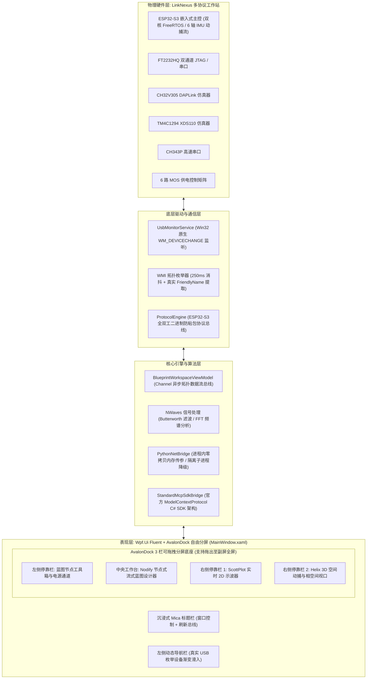

# LinkNexus — 多协议桌面硬件调试站与智能供电管理中枢

<div align="center">

-blue?style=for-the-badge&logo=windows)


**面向嵌入式软硬件调试的高质感桌面中枢，支持 Windows PnP 动态设备流、流式固件烧录、智能串口 CLI、节点式流式蓝图引擎、ScottPlot 高速示波器、Helix 3D 空间动捕、AvalonDock 多屏自由分屏与 MCP (Model Context Protocol) AI Agent 架构体系**

[功能规格说明书](docs/README_FUNCTIONAL.md) • [硬件端口重映射指南](docs/README_PortMapping.md) • [ESP32-S3 下位机固件文档](firmware/README.md) • [固件设计审查备忘录](firmware/README-DESIGN.md) • [快速构建](#快速构建与运行)

</div>

---

## 项目背景与设计重点

在日常嵌入式硬件研发与打样调试中，桌面常堆叠 JTAG、CMSIS-DAP、TI XDS 探针及各类 USB 转串口板卡，既挤占上位机端口，又因传统工具界面杂乱、缺乏硬件状态互锁而增加操作成本。

**LinkNexus** 聚焦以下核心架构与工程体验：

- **Wpf.Ui 现代暗黑微质感与 Mica 亚克力**：主窗体基于 `Wpf.Ui.Controls.FluentWindow` 构建，开启 `WindowBackdropType="Mica"` 原生暗黑亚克力微质感背景，严格满足 WCAG 2.1 AA 级对比度要求。
- **AvalonDock 自由拖拽分屏底座 (VS / Blender 交互体验)**：采用 `Dirkster.AvalonDock` 构建可拆分停靠三栏底座（左侧边栏工具箱、中央 Nodify 蓝图画布、右侧多通道示波器与 3D 动捕视口）。支持标签式自由合并、无级分屏分割、自动隐藏，以及**将示波器与 3D 视口一键拖拽出主窗体作为独立浮动窗口并跨屏/副屏全屏沉浸观看**。
- **Nodify 节点式流式蓝图设计器**：基于 `Nodify` 现代虚拟化画布与三阶贝塞尔曲线吸附连线，底层采用 `Channel<BlueprintPacket>` 内存微秒级异步拓扑总线，支持各 COM / MCP 输入、算子计算、波形绘制、相空间分析与 CSV 落盘。
- **ScottPlot 实时 2D 示波器**：集成 `ScottPlot.WPF` Skia 硬件加速引擎，采用暗黑工业调色板，提供多通道实时曲线流式渲染、自适应缩放、波形一键冻结与循环滚动缓冲。
- **HelixToolkit 3D 引擎动捕与相空间轨迹视口**：
  * **实物旋转同步动捕**：右手系三维视口内嵌 3D 硬件载体，实时响应下位机 6 轴 IMU（MPU6050 / ICM-42688）四元数与欧拉角动态流，实现毫秒级实物姿态孪生镜像；
  * **三维相空间轨道流**：提供 `PhaseSpace3DPlotNode` 蓝图节点，实时解算三通道坐标或差分相空间轨迹 $(x, \dot{x}, \ddot{x})$，通过 `LinesVisual3D` 高速流式追加三维空间吸引子动态轨迹。
- **NWaves 数字信号处理算法组**：集成 `NWaves` 经典数字信号处理库，提供 `DspFilterNode` 蓝图算子，支持 Butterworth 低通/高通/带通数字滤波、滑动平均、中值去噪与实数 FFT 频谱峰值频率实时提取。
- **ModelContextProtocol (MCP) 官方 C# SDK 规范集成**：基于 `modelcontextprotocol/csharp-sdk` 规范，提供 `StandardMcpSdkBridge` 与双模（GUI / `--mcp` Stdio）运行架构，标准化导出 12 项硬件调试与蓝图编排 AI Tool 以及 3 组系统 Resources。
- **pythonnet 进程内零拷贝内存传参**：通过 `PythonNetBridge` 与 `Py.GIL()` 将数据流直接在 C# 托管内存与 Python 算法核之间传递，消除磁盘中间文件开销，且 Git 严格保持 0 个 `.py` 文件追踪。
- **Windows PnP 真实硬件枚举与侧边栏动态路由**：严格绑定 Windows 设备管理器识别的友好名称，物理设备接入时在侧边栏平滑渐变滑入专属工作台（固件烧录、内核调试、串口终端），拔出即销毁，绝不产生占位虚假端口。

---

## 🏛️ 系统拓扑与分层架构



---

## ⚡ 核心功能与使用指南

### 1. AvalonDock 自由分屏与多屏沉浸工作台
- **VS / Blender 级停靠**：主画布、示波器卡片、3D 视口均可自由拖拽吸附至左、右、上、下任意边界，或堆叠为标签页；
- **跨屏与副屏全屏**：抓住 `ScottPlot 实时 2D 示波器` 或 `Helix 3D 空间动捕与相空间轨迹` 标题栏向外拖拽，即可脱离主界面形成独立窗口；将窗口拖至副屏并双击最大化，即刻开启大屏全景波形与 3D 姿态观测。

### 2. Nodify 节点式流式蓝图引擎
- **丰富算子库**：支持动态追加 DSP 滤波节点、3D 相空间轨迹节点、VOFA+ 实时示波卡片、IMU 姿态视窗、Python 算法算子、CSV 落盘节点、数学算子、ESP32 串口输入以及 MCP 智能体协议桥接；
- **智能连线**：拖拽引脚自动生成三阶贝塞尔连接线，支持类型自动兼容校验与右键动态拆分/合并多通道流；
- **缩放与平移**：支持鼠标滚轮以光标为中心在 `0.35x ~ 2.40x` 范围内平滑缩放，中键或右键拖拽自由平移画布。

### 3. ScottPlot 硬件加速 2D 示波器
- 实时吞吐下位机高速数据流，利用 Skia 显卡着色器实现 60 FPS 稳定刷新；
- 支持通道数值实时读数、波形动态冻结查看、Y 轴自适应缩放与数据缓冲区一键清空。

### 4. HelixToolkit 3D 空间动捕与相空间轨迹
- **6 轴实物旋转同步动捕**：下位机固件启动 `telemetry imu true` 时，3D 视口内载体实时随物理硬件转动，呈现平滑欧拉角与四元数姿态；
- **三维相空间轨道**：将任意单通道或多通道信号接入 `PhaseSpace3DPlotNode`，即可在 3D 视口中以三维几何轨迹展现信号的相空间动态吸引子。

### 5. NWaves 经典数字信号处理算子
- 蓝图中内嵌 `DspFilterNode`，可在数据流传输过程中即时应用 Butterworth 低通、高通、带通滤波，或滑动平均、中值滤波去噪；
- 支持基于 `RealFft` 实时提取信号的峰值频率并输出。

### 6. ModelContextProtocol (MCP) AI 智能体接入
- **Dual-Mode 启动架构**：
  * **默认模式**：启动桌面 GUI，并在后台常驻 MCP 本地管道 IPC 服务；
  * **Stdio 模式 (`--mcp`)**：供外部 AI Agent (Claude Desktop、Cursor 等) 直接拉起并作为标准 MCP 服务器通信。
- **12 项核心 AI 工具**：包含 `list_devices`、`send_serial_command`、`control_mos_power`、`flash_kernel_control`、`push_blueprint_data`、`blueprint_orchestrate`、`blueprint_get_state`、`blueprint_analyze_mcp_node`、`blueprint_tune_python_params` 等；
- **3 组标准 Resource**：实时共享蓝图全量拓扑图、MCP 节点信号统计量以及外部 Python 算法仓库白名单。

---

## 🏷️ 版本号规范体系

LinkNexus 采用严格的工程规范版本号定义：

$$\mathbf{v[X].[xx]-[AAA].[YY][WW]}$$

| 字段 | 含义 | 说明 | 示例 |
| :---: | :--- | :--- | :---: |
| `X` | 大版本号 (Major) | 架构级或重大版本推进 (不补零) | `0`、`1` |
| `xx` | 小版本修改号 (Minor) | 功能特性迭代或小版本更新 (两位补零) | `35` |
| `AAA` | 修订与发布阶段 (Stage) | 语义化阶段标识：`preview` / `beta` / `release` | `preview` |
| `YYWW` | 年周数 (Year-Week) | 年份后两位 + ISO 8601 自然周数 (01 ~ 53) | `2641` (2026年第41周) |

> 当前工程基线版本：**`v0.35-preview.2641`**

---

## 🚀 快速构建与运行

### 环境准备
- 操作系统：Windows 10 / 11 (x64)
- 运行框架：[.NET 10.0 SDK](https://dotnet.microsoft.com/download/dotnet/10.0) 或更高版本
- IDE 推荐：Visual Studio 2022+ / Visual Studio Code (C# Dev Kit)

### 编译源码
```bash
# 1. 克隆代码仓库
git clone https://github.com/WeiXIngJIaHe/LinkNexus.git
cd LinkNexus

# 2. 还原 NuGet 依赖
dotnet restore LinkNexus/LinkNexus.csproj

# 3. 编译工程 (Release 优化配置，0 警告 0 错误)
dotnet build LinkNexus/LinkNexus.csproj -c Release
```

### 一键脚本发布 (Publish.bat)
仓库根目录下提供了自动化打包脚本 [`Publish.bat`](file:///C:/Users/17368/source/repos/LinkNexus/Publish.bat)：
```bat
# 运行自动化发布脚本生成以下两套交付件：
# 1. 框架依赖轻量包: Publish_FrameworkDependent/
# 2. 独立自包含免安装运行包 (内置 .NET 运行时，即开即用): Publish_SelfContained/
Publish.bat
```

---

## 📂 工程核心目录结构

```text
LinkNexus/
├── LinkNexus/                       # Windows 上位机工程 (.NET 10.0 WPF / C#)
│   ├── App.xaml / App.xaml.cs       # 应用程序入口 (Dual-Mode: GUI 桌面 / --mcp Stdio 模式)
│   ├── MainWindow.xaml / .xaml.cs   # Wpf.Ui Fluent 主窗体接管 Win32 消息泵与 AvalonDock 底座
│   ├── MainViewModel.cs             # 顶层 MVVM 反应式业务调度中枢
│   ├── Blueprint/                   # 节点式流式蓝图子系统 (Nodify / 拓扑总线)
│   │   ├── Controls/                # 蓝图工作台、ScottPlot 示波器与 Helix 3D 视口控件
│   │   │   ├── BlueprintWorkspaceControl.xaml
│   │   │   ├── ScottPlotOscilloscopeControl.xaml  # ScottPlot 实时示波器控件
│   │   │   ├── Helix3DViewportControl.xaml        # HelixToolkit 3D 动捕与相空间控件
│   │   │   └── NodeCardControl.xaml               # 节点卡片自定义控件模板
│   │   ├── Core/                    # 蓝图核心总线、数据包与 PythonNet 内存桥接
│   │   │   ├── BlueprintPacket.cs                 # 流式数据包契约 (FireWater / 标签 / 频道)
│   │   │   ├── NodeBase.cs                        # 蓝图节点抽象基类 (Nodify 坐标 / 引脚)
│   │   │   └── PythonNetBridge.cs                 # pythonnet 进程内零拷贝内存传参桥接器
│   │   ├── Nodes/                   # 蓝图功能算子节点实现
│   │   │   ├── DspFilterNode.cs                   # NWaves 数字信号滤波与 FFT 算子
│   │   │   ├── PhaseSpace3DPlotNode.cs            # 3D 相空间轨迹解算节点
│   │   │   ├── Imu3DPlotNode.cs                   # 6 轴 IMU 姿态解算视窗节点
│   │   │   ├── ComInputNode.cs / ComOutputNode.cs # 真实 USB 串口流输入/输出节点
│   │   │   ├── VofaPlotNode.cs                    # VOFA+ 多通道示波卡片节点
│   │   │   ├── PythonAlgoNode.cs                  # 隔离 Python 算法算子节点
│   │   │   └── CsvLoggerNode.cs                   # 实时数据流落盘节点
│   │   └── ViewModels/              # 蓝图画布与连线拓扑 ViewModel
│   ├── Mcp/                         # Model Context Protocol (MCP) AI 智能体体系
│   │   ├── StandardMcpSdkBridge.cs  # 官方 ModelContextProtocol C# SDK 适配器
│   │   ├── McpServerBridge.cs       # MCP 服务端分发中枢
│   │   ├── McpStdioHandler.cs       # Stdio 命令行流式处理器
│   │   └── Tools/                   # 12 项硬件调试与蓝图编排 AI 工具集
│   ├── ProtocolEngine.cs            # ESP32-S3 全双工二进制防粘包协议引擎
│   ├── UsbMonitorService.cs         # Win32 RegisterDeviceNotification 与 WMI 消抖枚举
│   └── LinkNexus.csproj             # .NET 10.0 WPF 现代化工程定义文件
├── firmware/                        # ESP32-S3 下位机嵌入式固件 (ESP-IDF v5.x / C++17)
│   ├── include/                     # 双核任务、互斥锁、6 轴 IMU 遥测与协议头文件
│   ├── src/                         # 模块化 C++ 实现
│   ├── platformio.ini               # PlatformIO 构建配置
│   ├── CMakeLists.txt               # ESP-IDF 顶层构建配置
│   ├── README.md                    # 固件专属架构说明与协议技术文档
│   └── README-DESIGN.md             # 固件设计审查与修改演进备忘录
├── docs/
│   ├── README_FUNCTIONAL.md         # 详细功能规格与底层技术规范书
│   └── README_PortMapping.md        # PCB 硬件工程师端口映射与跳线适配指南
├── Publish.bat                      # Windows 一键全量编译与双版本发布批处理脚本
└── README.md                        # 本说明文档
```

---

## ⌨️ 常用快捷键与交互一览

| 触发操作 | 目标动作 | 作用说明 |
| :--- | :--- | :--- |
| **拖拽示波器 / 3D 视口标题** | 浮动独立视窗 / 跨屏展示 | 将 2D 示波器或 3D 视口拎出主界面，支持副屏全屏无缝观察 |
| **鼠标滚轮** | 蓝图画布缩放 | 以当前鼠标光标所在点为中心，在 `0.35x ~ 2.40x` 平滑无级缩放 |
| **画布中键 / 右键拖拽** | 蓝图画布平移 | 自由漫游大型蓝图设计拓扑图 |
| **双击设备卡片就绪指示** | 唤醒 ESP32 终端 | 弹出 ESP32-S3 原生交互式悬浮 CLI 终端窗口 |
| **全窗口拖拽文件** | 固件载入与架构识别 | 拖入 `.bin` / `.hex` 文件，自动激活固件烧录工作台并解析 CRC32 |
| **命令行 `--mcp`** | 启动 MCP Stdio 模式 | 无头后台运行，供外部 AI Agent (Claude / Cursor) 自动化挂接与调度 |

---

## 📄 开源许可证 (License)

本项目基于 [MIT License](LICENSE) 开源。欢迎各类商业与非商业嵌入式开发、测试仪器集成与教学科研使用。
