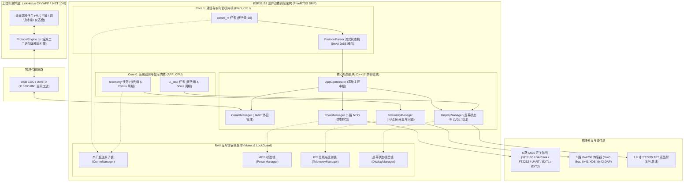

# LinkNexus — ESP32-S3 双核嵌入式主控固件

<div align="center">


**面向 LinkNexus 多协议桌面硬件调试站的底层嵌入式主控固件。基于 ESP-IDF 与 C++17 现代化面向对象架构构建，提供 FreeRTOS 双核并发调度、流式二进制防粘包协议总线、3 路 INA236 母线与支路遥测采集、6 路 MOS 供电开通/隔离控制及 ST7789 / LVGL UI 架构演进支持。**

[分层拓扑与双核调度](#️-系统拓扑与分层架构) • [通信协议与上位机对齐](#-通信协议与上位机对齐) • [硬件控制与引脚分配](#-硬件控制与引脚分配) • [快速构建与烧录](#-快速构建与烧录)

</div>

---

## 项目背景与设计重点

在嵌入式硬件测试与调试场景中，ESP32-S3 承担 LinkNexus 桌面硬件调试站的底层总线守护与外设供电控制中枢角色。本固件与 Windows 端 C# (.NET 10.0 WPF) 上位机深度闭环协同，重点解决以下架构与工程问题：

- **C++17 模块化高内聚解耦**：工程全面升级为 C++17 架构，严格遵循职责分离规范。`main.cpp` 仅负责顶层协调器初始化与生命周期启动，底层外设驱动、协议流解包、传感器采集与 UI 渲染全部封装为独立功能模块，彻底消除单文件堆砌与全局耦合。
- **FreeRTOS 双核对称并发与线程安全 (Thread Safety)**：
  * **Core 1 (PRO_CPU)**：绑定高速串口全双工通信与流式协议解包任务（`comm_rx`，优先级 10），确保上行/下行指令微秒级响应不卡顿；
  * **Core 0 (APP_CPU)**：绑定传感器 I2C 遥测任务（`telemetry`，优先级 5，周期 250ms）与板载屏幕 UI 渲染任务（`ui_task`，优先级 4，周期 50ms）；
  * **全链路 RAII 互斥锁保护**：引入 `Mutex` 与 `LockGuard` 守卫，针对 GPIO 电源切换、I2C 总线读写、串口帧并发发送提供硬件级原子性保护，彻底根除双核并发调用导致的野指针、总线死锁与数据撕裂。
- **全双工二进制防粘包流式协议**：与上位机 `ProtocolEngine.cs` 严格二进制对齐。采用 `[0xAA 0x55]` 引导头、累加和校验与有限状态机（FSM），在不稳定链路与断包工况下具备自动重同步与抗干扰能力。
- **高精度母线/支路遥测与安全互锁**：支持 3 路 INA236（主母线、XDS110、DAPLink）实时采样，提供通道断电时数据归零保护；在脱机无传感器环境下提供微扰平滑仿真回退，保障上位机界面联调。
- **预留 1.9 寸 ST7789 屏幕与 LVGL UI 架构**：支持上位机 0x20 命令反向同步当前选定通道、固件烧录进度（0~100%）与设备友好名称，抽象出清晰的 UI 局部刷新管道与 LVGL 任务循环接口。

---

## 🏛️ 系统拓扑与分层架构



---

## ⚡ 核心功能与运行机制

### 1. 极简入口与模块化工程解耦
遵循嵌入式规范设计，`src/main.cpp` 剔除所有底层硬件细节与配置代码，仅保留系统单例调度：

```cpp
#include "app_coordinator.hpp"

extern "C" void app_main(void)
{
    LinkNexus::AppCoordinator::Instance().Init();
    LinkNexus::AppCoordinator::Instance().Start();
}
```

底层划分为 5 大高内聚子模块：
- `CommManager`：接管串口硬件驱动配置，提供互斥锁保护的 `SendRawFrame`，杜绝 Core 0 周期数据包与 Core 1 异步响应包相互插字；
- `ProtocolParser` / `ProtocolUtils`：纯协议流解析与报文组帧，零动态内存分配；
- `PowerManager`：维护 6 路 MOS 通道状态，提供原子查询与开关切换；
- `TelemetryManager`：接管 I2C0 总线，提供物理芯片采样与断网自适应微扰仿真；
- `DisplayManager`：维护上位机同步数据模型，预留 LVGL 渲染管线。

---

### 2. 双核对称并发与互斥锁安全体系

| 任务名称 | 绑定核心 | 优先级 | 周期 / 触发源 | 职责说明 | 关联互斥锁 |
| :--- | :---: | :---: | :---: | :--- | :--- |
| `comm_rx` | **Core 1** | 10 | 串口中断 / 20ms 等待 | 高速读取串口字节流，送入协议状态机，即时分发命令 | `TxLock` (发送ACK) |
| `telemetry` | **Core 0** | 5 | 250ms 定时 | 读取 3 路 INA236 数据，组装 0x10 数据帧并上报上位机 | `I2cLock`、`TxLock` |
| `ui_task` | **Core 0** | 4 | 50ms 定时 | 处理屏幕数据脏标志，驱动 ST7789 局部重绘与 LVGL 调度 | `UiLock` |

- **防竞争机制**：Core 1 收到 `0x30` 通道供电控制指令时调用 `PowerManager::SetPower` 修改状态；与此同时 Core 0 上的 `telemetry` 任务读取通道状态以判定是否将该通道电流电压归零。双方均通过 `PowerManager` 内置互斥锁加锁访问，消除数据竞争。

---

## 📡 通信协议与上位机对齐

固件通信协议与 C# 端 `LinkNexus.ProtocolEngine` 严格一致：

### 帧格式定义 (Frame Format)

| 偏移 (Bytes) | 字段名 | 类型 | 说明 |
| :---: | :---: | :---: | :--- |
| `0` | **Header 1** | `uint8_t` | 固定同步字 `0xAA` |
| `1` | **Header 2** | `uint8_t` | 固定同步字 `0x55` |
| `2` | **Cmd** | `uint8_t` | 功能命令字 |
| `3` | **Length** | `uint8_t` | 载荷长度 $N$ ($0 \le N \le 255$) |
| `4 ~ 4+N-1` | **Payload** | `uint8_t[N]` | 有效业务数据载荷 |
| `4+N` | **Checksum** | `uint8_t` | 累加和校验：$\sum (\text{H1} + \text{H2} + \text{Cmd} + \text{Len} + \text{Payload}) \pmod{256}$ |

### 核心命令集与报文结构

| 命令字 (CMD) | 传输方向 | 名称 | 载荷长度 | 载荷内容 (Payload) 详解 |
| :---: | :---: | :--- | :---: | :--- |
| `0x01` | 上位机 $\rightarrow$ ESP32 | **心跳维持请求** | 1 字节 | `[Sequence]` (帧序号) |
| `0x01` | ESP32 $\rightarrow$ 上位机 | **心跳维持应答** | 1 字节 | `[0x06]` (标准 ACK 确认) |
| `0x10` | ESP32 $\rightarrow$ 上位机 | **INA236 遥测上报** | 12 字节 | 3 组小端序测量值：<br>• 母线电压 (mV, 2B) + 母线电流 (mA, 2B)<br>• XDS 电压 (mV, 2B) + XDS 电流 (mA, 2B)<br>• DAP 电压 (mV, 2B) + DAP 电流 (mA, 2B) |
| `0x20` | 上位机 $\rightarrow$ ESP32 | **屏幕状态同步** | $4 + M$ 字节 | `[ActiveCh (1B)]` + `[Progress (1B)]` + `[Flags (1B)]` + `[NameLen (1B)]` + `[DeviceName (M 字节 UTF-8)]` |
| `0x30` | 上位机 $\rightarrow$ ESP32 | **MOS 供电控制** | 2 字节 | `[Channel (1B)]` + `[State (0:关断 / 1:导通)]` |
| `0x30` | ESP32 $\rightarrow$ 上位机 | **供电控制回执** | 2 字节 | `[Channel (1B)]` + `[State (0:关断 / 1:导通)]` |

---

## 🔌 硬件控制与引脚分配

引脚分配与 LinkNexus 物理 PCB 及上位机 `HardwareConfig.json` 保持严格映射：

### 1. 6 路 MOS 电源控制 GPIO

| 通道索引 | 逻辑名称 | 对应芯片 / 接口 | ESP32-S3 GPIO | 默认上电状态 |
| :---: | :--- | :--- | :---: | :---: |
| `0` | **CH0_XDS** | TI XDS110 隔离烧录器 | `GPIO 4` | 导通 (ON) |
| `1` | **CH1_DAP** | ARM DAPLink 仿真器 | `GPIO 5` | 导通 (ON) |
| `2` | **CH2_FT2232** | FT2232HQ 双通道调试器 | `GPIO 6` | 导通 (ON) |
| `3` | **CH3_UART** | 高速虚拟串口 (VCP) | `GPIO 7` | 导通 (ON) |
| `4` | **CH4_EXT1** | USB 下行扩展端口 1 | `GPIO 15` | 导通 (ON) |
| `5` | **CH5_EXT2** | USB 下行扩展端口 2 | `GPIO 16` | 导通 (ON) |

### 2. INA236 I2C 采样总线

| 外设管脚 | ESP32-S3 GPIO | 说明 |
| :--- | :---: | :--- |
| **I2C SDA** | `GPIO 8` | 开漏输出，板载 4.7kΩ 上拉电阻 |
| **I2C SCL** | `GPIO 9` | I2C 时钟总线，标称速率 400 kHz |
| **主母线采样芯片** | 地址 `0x40` | 检测整机总输入供电电压与主电流 |
| **XDS110 支路采样** | 地址 `0x41` | 检测 XDS110 供电回路独立功耗 |
| **DAPLink 支路采样** | 地址 `0x42` | 检测 DAPLink 供电回路独立功耗 |

### 3. 主控通信串口

| 串口信号 | 对应外设 | 波特率配置 | 数据格式 | 说明 |
| :--- | :---: | :---: | :---: | :--- |
| **UART0 TX / RX** | `UART_NUM_0` | 115200 bps | 8 数据位, 无校验, 1 停止位 | 连接 USB CDC 虚拟串口芯片与上位机通信 |

---

## 🏷️ 版本号规范体系

固件版本号与 LinkNexus 桌面端软件版本严格保持一致，基于规范基线推进：

$$\mathbf{v[X].[xx]-[AAA].[YY][WW]}$$

- **当前固件基准版本**：**`0.13-preview-2641`**
- 同步写入：
  * C++ 头文件宏定义：[`include/linknexus_config.hpp`](file:///c:/Users/17368/Desktop/LinkNexus/include/linknexus_config.hpp)
  * CMake 顶层项目版本：[`CMakeLists.txt`](file:///c:/Users/17368/Desktop/LinkNexus/CMakeLists.txt)
  * 上位机握手识别标识与文档说明

---

## 🚀 快速构建与烧录

### 开发环境依赖
- **推荐工具链**：VS Code + PlatformIO IDE 插件 或 ESP-IDF v5.x 终端环境
- **硬件开发板**：ESP32-S3-DevKitM-1 (8MB Flash / Octal PSRAM)
- **依赖库**：ESP-IDF 原生驱动组件（无需第三方外部库）

### PlatformIO 构建指令
```bash
# 1. 切换至固件工程目录
cd LinkNexus

# 2. 编译固件二进制镜像
pio run

# 3. 烧录固件至目标板 (自动探测可用 COM 端口)
pio run --target upload

# 4. 开启串口控制台监视固件运行日志 (115200 波特率)
pio device monitor -b 115200
```

### 固件烧录镜像输出说明
编译完成后将在 `.pio/build/esp32-s3-devkitm-1/` 下生成以下交付镜像：
- `bootloader.bin` (偏移 `0x0000`)：二级引导程序
- `partitions.bin` (偏移 `0x8000`)：分区表镜像
- `firmware.bin` (偏移 `0x10000`)：应用固件核心代码
- `firmware.factory.bin`：单文件整包出厂镜像，可直接用 ESP 烧录工具一键刷写

---

## 📂 工程核心目录结构

```text
LinkNexus/
├── include/                         # 公共接口头文件目录
│   ├── linknexus_config.hpp         # 引脚映射、版本号常量与双核调度配置
│   ├── freertos_mutex.hpp           # FreeRTOS 互斥锁 RAII 包装器 (Mutex & LockGuard)
│   ├── protocol.hpp                 # 二进制帧结构、命令字枚举与流式解包状态机
│   ├── power_manager.hpp            # 6 路 MOS 供电控制管理器头文件
│   ├── telemetry_manager.hpp        # 3 路 INA236 I2C 采样与平滑仿真头文件
│   ├── display_manager.hpp          # 屏幕状态同步与 LVGL UI 架构头文件
│   ├── comm_manager.hpp             # UART 通信外设驱动与线程安全发送头文件
│   └── app_coordinator.hpp         # 系统顶层生命周期与双核任务协调器头文件
├── src/                             # 模块化 C++ 实现源文件
│   ├── CMakeLists.txt               # ESP-IDF 模块组件构建脚本
│   ├── main.cpp                     # 固件主入口 (仅保留顶层调度器启动调用)
│   ├── app_coordinator.cpp         # 协调器双核任务创建与协议分发实现
│   ├── comm_manager.cpp             # 串口驱动初始化与原子性帧发送实现
│   ├── protocol.cpp                 # 协议帧打包、解包与校验和算法实现
│   ├── power_manager.cpp            # 6 路 MOS GPIO 硬件驱动与互斥状态实现
│   ├── telemetry_manager.cpp        # INA236 I2C 总线读写与仿真回退实现
│   └── display_manager.cpp          # 屏幕状态模型缓存与 LVGL 刷新管线实现
├── platformio.ini                   # PlatformIO 编译环境配置文件
├── CMakeLists.txt                   # ESP-IDF 顶层 CMake 工程配置 (固定 PROJECT_VER)
├── sdkconfig.esp32-s3-devkitm-1     # ESP32-S3 专用 Kconfig 固化配置
├── README-DESIGN.md                 # 原始设计规格基准要求文档
└── README.md                        # 本固件核心工程架构说明文档
```

---

## 📄 开源许可证 (License)

本项目基于 [MIT License](LICENSE) 许可协议开源。

